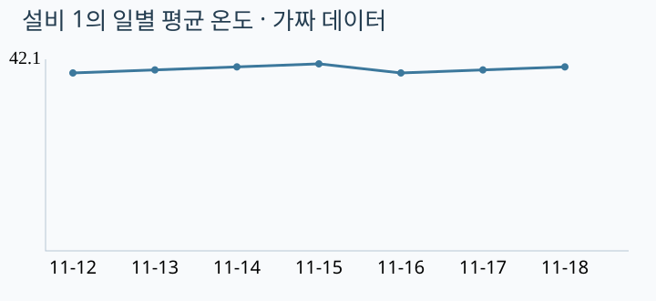
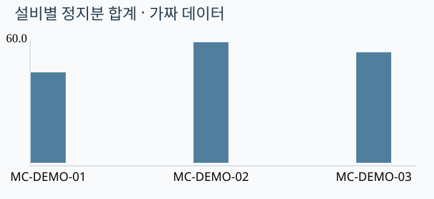
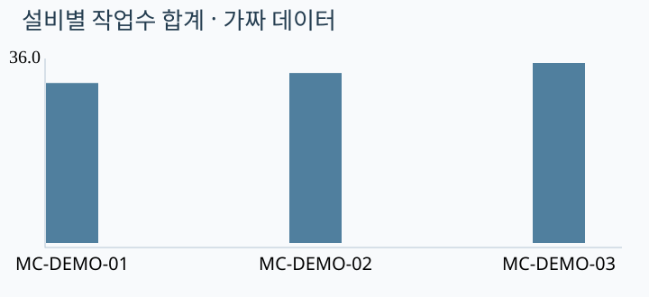
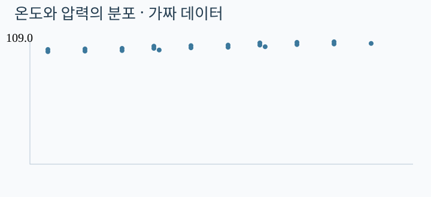
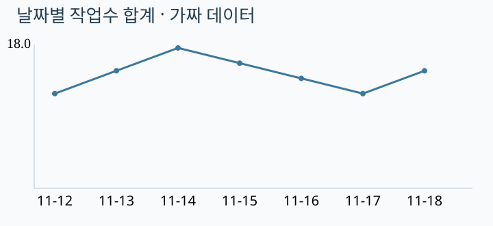
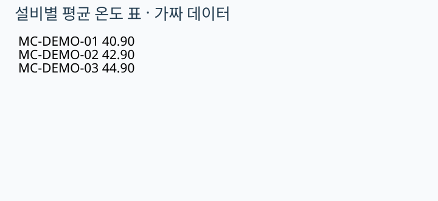

# 사내 오프라인 Streamlit 차트 키트

말로 매번 화면을 묘사하는 대신 **예제 번호 + 설정 JSON + 작업명세 + 참고 코드**를 사내 AI에게 전달한다. 회사 데이터를 반출하지 않고 회사 안에서 원천 필드만 연결한다. 이번 자료는 가짜 데이터 21행을 사용하며 실제 SSO·DB·Streamlit 서버와 연결하지 않았다.

## 먼저 눈으로 고르기

Streamlit 없이 `previews/index.html`을 로컬 브라우저에서 열 수 있다. Express 실행 중이면 `/streamlit-reference/`에서도 볼 수 있다. 이 페이지는 Streamlit 자체 화면이 아닌 **같은 집계 로직으로 생성한 정적 SVG 참고 화면**이다. 차트별 설정 JSON·사내 AI용 작업명세·Python 예제를 내려받는다.

| 예제 | 목적 | 미리보기 |
| --- | --- | --- |
| 01-trend | 설비 1의 일별 평균 온도 |  |
| 02-downtime | 설비별 정지분 합계 |  |
| 03-workload | 설비별 작업수 합계 |  |
| 04-scatter | 온도·압력의 분포 |  |
| 05-daily | 날짜별 작업수 합계 |  |
| 06-table | 설비별 평균 온도 표 |  |

예: **“02-downtime 기준으로 Y축만 처리시간 열에 연결하고 평균으로 집계해줘. 기존 설비 필터와 로그인은 유지해줘.”** 내려받은 작업명세와 해당 `.py`를 함께 주면 레이아웃·집계·검증 기준을 처음부터 설명하지 않아도 된다.

## 인터넷 없이 설치된 라이브러리 자체를 참고하기

```powershell
python streamlit-kit/inspect_environment.py
python streamlit-kit/inspect_environment.py --docstrings
```

버전·지원 함수·실제 함수 시그니처와 필요할 때 docstring을 읽는다. 인터넷 검색이나 패키지 설치를 하지 않는다. 사내 AI에게 이 출력과 예제 코드를 함께 주면 최신 인터넷 예제를 추측해서 쓰는 일을 줄일 수 있다. 이 환경 보고서는 사내에서만 사용하고 외부 Git에 올리지 않는다. 패키지 소스 전체·설정·환경 변수·실제 자료는 수집하지 않는다.

## 실제 Streamlit 작업대

회사에 이미 설치된 승인된 환경에서만 다음을 실행한다. 이 저장소는 Streamlit/Python 패키지를 새로 설치하거나 업그레이드하지 않는다.

```powershell
cd streamlit-kit
python -m streamlit --version
python -m streamlit run app.py
```

`app.py`는 예제·차트 종류·X/Y·집계·설비·누락 처리 선택 → 설정 적용 → 결과/표 → JSON·작업명세·참고 코드 내려받기 흐름이다. 다운로드 버튼은 form 밖에 둔다. 생성 코드를 앱이 실행하지 않으며 선택된 고정 렌더러만 호출한다. Python 예제 파일은 `chart_core.py` 옆에 놓고 내용을 검토한 뒤 사용한다.

**검증 범위:** 현재 개발 PC는 Python 3.9.6이며 Streamlit은 설치되어 있지 않다. 따라서 실제 Streamlit 렌더링·위젯·다운로드 동작은 이 환경에서 실행 검증하지 않았다. Python 처리 로직 5개 테스트, Python 소스/생성 코드 문법, 별도 HTML/SVG 미리보기와 작업명세 다운로드를 검증했다. 회사에 설치된 Streamlit/Python 버전과 지원 API를 먼저 확인한다. 특정 최소 버전이나 모든 버전의 호환을 보장하지 않는다.

## 파일 지도

| 파일 | 역할 |
| --- | --- |
| `chart_core.py` | 고정 명세 검증·가짜 행·집계·작업명세·참고 코드 생성 |
| `app.py` | Streamlit 작업대. 실제 데이터는 sample_rows 연결부만 사내에서 교체 |
| `build_preview.py` | 같은 명세/집계로 정적 예제·JSON·Markdown·Python 생성 |
| `previews/` | 인터넷 없이 보고 비교하는 미리보기와 내려받기 파일 |
| `.streamlit/config.toml` | 루프백·CORS/XSRF 유지·usage stats 비활성 예시 |
| `inspect_environment.py` | 설치된 버전·공개 API 시그니처/docstring을 사내에서 조회 |
| `QUICKREF.md` | 자주 쓰는 API와 성능/캐시/보안 지침을 자체 요약 |
| `test_chart_core.py` | 표준 라이브러리만 쓰는 회귀 테스트 |

## 명세와 실제 데이터의 경계

`version,title,chart,x,y,aggregate,equipment,missing` 8개 필드만 사용한다. URL·SQL·코드·쿠키·비밀번호를 받지 않는다. 실제 원천 열이 다르면 사내에서 명시적인 이름/자료형 매핑을 만든다. 현재 설비 허용 목록은 MC-DEMO-01~03뿐이다. 이 목록을 실제 부서/사용자 리소스 권한 검사로 교체해야 한다.

집계는 none/sum/mean이며 막대는 sum/mean을 명시한다. 산점도는 숫자 X/Y와 none만 허용한다. 날짜는 YYYY-MM-DD, 숫자는 유한값만 사용한다. 잘못된 값은 drop 시 제외 수를 표시하고 error 시 중단한다. 0으로 채우거나 보간하지 않는다. 최대 원본 50,000행·표시 2,000점이며 넘으면 오류로 집계를 요청하고 조용히 자르지 않는다. 일별 평균을 다시 평균내는 식의 중복 집계를 피하고 회사에서 집계 단위·분모·교대 기준·단위를 확정한다.

현재 지원은 단일 Y의 선·막대·산점도·집계 표다. 다중 계열, 관리도/SPC, 히트맵, 예측, 드래그 편집은 제공하지 않는다. 차트 번호를 기반으로 다음 기능을 한 개씩 추가하고 테스트를 함께 고친다.

## 인터넷 없는 사내 작업 순서

1. 사내 AI가 기존 프로젝트의 Python/Streamlit/차트 라이브러리 버전을 기록한다. `pip freeze` 결과를 외부로 보내지 않는다.
2. 미리보기 번호를 고르고 JSON·작업명세·참고 코드를 사내 AI에게 준다. 실제 행 대신 열 이름·형식·단위·빈 값 규칙과 가짜 5행을 전달한다.
3. 기존 DB/자료 로더는 유지하고 `prepare_points` 입력으로 들어가는 필드 변환만 먼저 만든다.
4. 하나의 작은 함수/페이지만 수정한다. 오류가 나면 사내에서 traceback과 재현 가능한 가짜 입력을 제시한다. 실제 자료·토큰이 든 로그는 외부로 보내지 않는다.
5. 합계/평균·필터·누락·빈 결과·날짜 순서·범위를 테스트하고 실제 Streamlit 화면을 확인한다.
6. 성능은 원본 조회·집계·렌더링 시간을 나누어 같은 조건에서 측정한다. 바꿀 때마다 전체 앱을 새로 작성하지 않는다.

## 테스트와 예제 재생성

```powershell
$env:PYTHONDONTWRITEBYTECODE='1'
python -m unittest discover -s streamlit-kit -p 'test_*.py' -v
python streamlit-kit/build_preview.py
```

위 명령은 저장소 루트 기준이다. 표준 라이브러리만 사용하며 인터넷 연결이나 Streamlit 설치가 필요 없다. 미리보기 생성은 가짜 데이터 전용이다. 실제 회사 데이터를 연결한 결과를 GitHub에 다시 올리지 않는다.

프로젝트가 폐쇄망이라고 해서 라이브러리의 모든 송신까지 자동 검증된 것은 아니다. 설정의 gatherUsageStats=false와 함께 해당 사내 버전·플러그인·프록시·브라우저/서버 방화벽에서 실제 송신을 확인한다. 외부 CDN/지도/이미지/컴포넌트나 원격 AI를 추가하지 않는다. 회사 자료를 밖으로 보내는 테스트는 하지 않는다.
